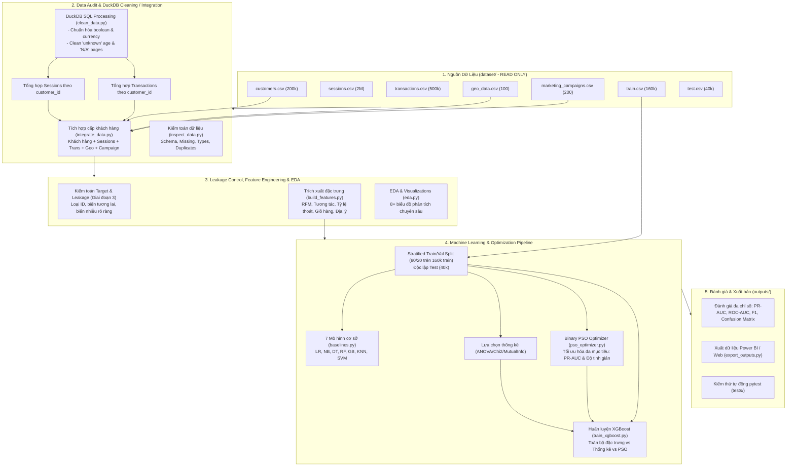

# ARCHITECTURE & PIPELINE DESIGN

Tài liệu này mô tả kiến trúc hệ thống và luồng xử lý toàn diện của dự án **Global E-Commerce Customer Purchase Prediction**.

---

## 1. Sơ đồ kiến trúc tổng thể (Mermaid Architecture Diagram)

---

## 2. Các thành phần hệ thống

### 2.1. Module Xử lý Dữ liệu lớn bằng DuckDB (`src/data/`)
- **Vấn đề**: `sessions.csv` có 2 triệu dòng, `transactions.csv` có 500,000 dòng. Nếu JOIN trực tiếp 2 bảng này trước khi tổng hợp, ma trận kết hợp trung gian có thể phình to lên hàng chục triệu dòng, gây tràn RAM và làm méo mó các chỉ số thống kê.
- **Giải pháp**:
  - Dùng **DuckDB** để nhóm và tổng hợp song song `sessions` theo `customer_id` (tính: tổng phiên, tổng thời lượng, tổng giỏ hàng, tỷ lệ thoát trung bình, số phiên theo nguồn truy cập...).
  - Tổng hợp `transactions` theo `customer_id` (tính: tổng số đơn, tổng giá trị, đơn hàng trung bình, phân bổ phương thức thanh toán, tỷ lệ dùng voucher...).
  - Sau đó mới kết hợp các bảng đã tổng hợp với `customers.csv` và ánh xạ `geo_data.csv` cùng `marketing_campaigns.csv`. Đảm bảo kết quả đầu ra luôn có cấu trúc **1 dòng duy nhất cho mỗi khách hàng**.

### 2.2. Kiểm soát rò rỉ dữ liệu (Anti-Leakage Design)
- **Tách biệt ID**: `customer_id`, `session_id`, `transaction_id`, `campaign_id` bị loại khỏi ma trận đặc trưng mô hình.
- **Tiền xử lý trong Pipeline**: Các bước Imputation (điền thiếu) và Scaling (chuẩn hóa) được đóng gói trong Scikit-Learn Pipeline, chỉ `fit` trên tập con huấn luyện (Train split) để ngăn ngừa hiện tượng Data Snooping / Data Leakage sang tập Validation và Test.
- **Phân tách Stratified**: Do tỷ lệ target dương là 20.3%, chiến lược chia tập đảm bảo giữ nguyên tỷ lệ nhãn dương giữa tập huấn luyện và tập kiểm định nội bộ.

### 2.3. Bộ tối ưu hóa bầy đàn nhị phân (Binary PSO)
- **Biểu diễn hạt (Particle Representation)**: Mỗi hạt là một vector nhị phân $\mathbf{x}_i \in \{0, 1\}^D$, trong đó $D$ là tổng số lượng đặc trưng ứng viên. Giá trị $1$ biểu thị đặc trưng được chọn, $0$ biểu thị đặc trưng bị loại.
- **Quy tắc cập nhật**:
  - Tốc độ: $\mathbf{v}_i^{(t+1)} = w \mathbf{v}_i^{(t)} + c_1 r_1 (\mathbf{p}_i - \mathbf{x}_i^{(t)}) + c_2 r_2 (\mathbf{g} - \mathbf{x}_i^{(t)})$
  - Chuyển đổi xác suất bằng hàm Sigmoid: $S(v_{id}) = \frac{1}{1 + e^{-v_{id}}}$
  - Vị trí nhị phân: $x_{id}^{(t+1)} = 1$ nếu $rand() < S(v_{id})$, ngược lại $0$.
- **Hàm mục tiêu (Fitness Function)**:
  $$\text{Fitness} = \alpha \cdot \text{PR-AUC} + (1 - \alpha) \cdot \left(1 - \frac{\sum x_{id}}{D}\right)$$
  với $\alpha = 0.85$ để ưu tiên tối đa chất lượng dự đoán (PR-AUC vì dữ liệu mất cân bằng) đồng thời phạt các bộ đặc trưng cồng kềnh, khuyến khích tính tinh gọn (sparsity).

### 2.4. Khung đánh giá đa chiều (Evaluation Framework)
- Không chỉ dựa vào Accuracy (dễ ngộ nhận khi nhãn mất cân bằng 80:20).
- Tập trung vào:
  1. **PR-AUC (Precision-Recall Area Under Curve)**: Thước đo quan trọng nhất cho lớp thiểu số.
  2. **ROC-AUC**: Khả năng phân loại tổng thể giữa hai lớp.
  3. **F1-Score, Precision, Recall**: Đo lường tại ngưỡng xác suất tối ưu.
  4. **Số lượng đặc trưng (Feature Sparsity)**: Đánh giá độ gọn nhẹ của mô hình.
  5. **Thời gian chạy (Training & Inference Time)**: Đánh giá tính khả thi trong sản xuất.
