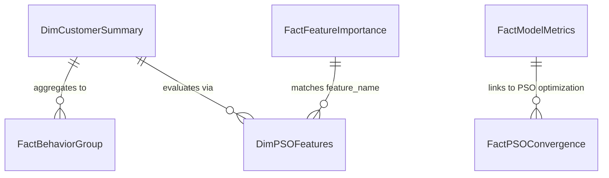

# POWER BI DATA MODEL SCHEMA & RELATIONAL ARCHITECTURE

Tài liệu này đặc tả chi tiết kiến trúc mô hình dữ liệu (Data Model Schema), các quan hệ thực thể, kiểu dữ liệu và bảng dữ liệu phục vụ xây dựng Dashboard Power BI cho dự án **Global E-Commerce Customer Purchase Prediction**.

---

## 1. TỔNG QUAN NGUỒN DỮ LIỆU ĐẦU VÀO (`outputs/powerbi/`)

Toàn bộ 6 tệp CSV trong thư mục `outputs/powerbi/` được trích xuất trực tiếp từ pipeline Python/DuckDB chuẩn hóa, loại bỏ hoàn toàn các trường dữ liệu thô cồng kềnh, tối ưu hóa kích thước và tốc độ tải vào Power BI:

| Tên bảng | File nguồn | Số dòng | Khóa chính (PK) | Mục đích phân tích |
| :--- | :--- | :---: | :---: | :--- |
| **DimCustomerSummary** | `dashboard_customer_summary.csv` | 200,000 | `customer_id` | Bảng thứ nguyên khách hàng trung tâm (RFM, demographic, tier, target, prediction) |
| **FactBehaviorGroup** | `dashboard_behavior_summary.csv` | 8 | Composite (`tier`, `target`) | Chỉ số hành vi trung bình theo phân khúc tier và trạng thái nhãn mua hàng |
| **FactModelMetrics** | `metrics_comparison.csv` | 5 | Composite (`model_name`, `feature_space`) | Bảng đo lường hiệu năng 5 thí nghiệm mô hình chính (PR-AUC, ROC-AUC, F1, Runtime) |
| **FactPSOConvergence** | `pso_convergence.csv` | 10 | `iteration` | Tiến trình hội tụ của thuật toán Binary PSO qua từng vòng lặp |
| **DimPSOFeatures** | `pso_selected_features.csv` | 17 | `feature_name` | Danh mục 17 đặc trưng được tối ưu lựa chọn bởi thuật toán Binary PSO |
| **FactFeatureImportance** | `feature_importance.csv` | 63 | `feature_name` | Trọng số tầm quan trọng của đặc trưng trích xuất từ mô hình XGBoost |

---

## 2. QUAN HỆ THỰC THỂ (RELATIONSHIP MAPPINGS)

Mô hình dữ liệu trong Power BI được thiết kế theo cấu trúc hình sao hỗn hợp (Extended Star / Constellation Schema):

### Chi tiết các liên kết:
1. **`FactFeatureImportance` $\to$ `DimPSOFeatures`**:
   - **Cột liên kết**: `feature_name` (Text)
   - **Loại quan hệ**: `1 to 1` hoặc `1 to Many`
   - **Hướng lọc chéo (Cross filter direction)**: `Both`
   - **Mục đích**: Cho phép lọc các đặc trưng quan trọng nhất thuộc danh sách 17 biến được chọn bởi PSO.

2. **`DimCustomerSummary` $\to$ `FactBehaviorGroup`**:
   - **Cột liên kết**: `customer_tier` và `target`
   - **Loại quan hệ**: `Many to 1`
   - **Hướng lọc chéo**: `Single` (FactBehaviorGroup lọc DimCustomerSummary)
   - **Mục đích**: Đối chiếu hành vi của từng khách hàng với mức trung bình của phân khúc tương ứng.

---

## 3. TỪ ĐIỂN CỘT VÀ KIỂU DỮ LIỆU POWER BI

### 3.1. Bảng `DimCustomerSummary` (`dashboard_customer_summary.csv`)
- `customer_id` (`Int64`): Mã định danh khách hàng duy nhất. Đặt thuộc tính: *Do Not Summarize*.
- `split_group` (`Text`): Phân nhóm dữ liệu (`train`, `test`).
- `target` (`Int64`): Nhãn thực tế (1: Mua hàng, 0: Không mua, Blank đối với Test).
- `age` (`Int64`): Độ tuổi khách hàng.
- `country` (`Text`): Quốc gia đã chuẩn hóa (`US`, `UK`, `DE`, `FR`, `IN`).
- `customer_tier` (`Text`): Hạng khách hàng (`Bronze`, `Silver`, `Gold`, `Platinum`).
- `loyalty_score` (`Decimal Number`): Điểm trung thành khách hàng (thang điểm 1 - 5).
- `total_spend` (`Decimal Number`): Tổng chi tiêu tích lũy qua tất cả giao dịch.
- `transaction_count` (`Int64`): Tổng số lượng đơn hàng đã thực hiện.
- `total_sessions` (`Int64`): Tổng số phiên truy cập web/app.
- `avg_session_duration_sec` (`Decimal Number`): Thời lượng phiên truy cập trung bình (giây).
- `avg_pages_per_session` (`Decimal Number`): Số trang xem trung bình mỗi phiên.
- `total_cart_additions` (`Int64`): Tổng số lần thêm sản phẩm vào giỏ hàng.
- `bounce_rate` (`Decimal Number`): Tỷ lệ phiên thoát của khách hàng (0.0 - 1.0).
- `marketing_campaign_tier` (`Text`): Phân khúc chiến dịch marketing (`Tier1`, `Tier2`, `Tier3`).
- `preferred_device` (`Text`): Thiết bị truy cập ưa thích (`Desktop`, `Mobile`, `Tablet`).

### 3.2. Bảng `FactModelMetrics` (`metrics_comparison.csv`)
- `experiment_id` (`Text`): Mã thí nghiệm (`E1`, `E2`, `E3`, `E4`, `E5`).
- `model_name` (`Text`): Tên thuật toán (`Baseline (Full Features)`, `Baseline (Statistical Features)`, `Baseline (PSO Features)`, `XGBoost (Full Features)`, `XGBoost (PSO Features)`).
- `feature_space` (`Text`): Không gian đặc trưng (`Full (63)`, `ANOVA (17)`, `PSO (17)`).
- `feature_count` (`Int64`): Số lượng đặc trưng đầu vào (63 hoặc 17).
- `pr_auc` (`Decimal Number`): Diện tích dưới đường cong Precision-Recall (PR-AUC).
- `roc_auc` (`Decimal Number`): Diện tích dưới đường cong ROC (ROC-AUC).
- `f1_score` (`Decimal Number`): F1-score tại ngưỡng $\tau = 0.50$.
- `precision` (`Decimal Number`): Độ chính xác (Precision).
- `recall` (`Decimal Number`): Độ nhạy (Recall).
- `accuracy` (`Decimal Number`): Độ chính xác tổng thể.
- `true_negatives` (`Int64`): Số lượng dự đoán Đúng Âm (TN).
- `false_positives` (`Int64`): Số lượng dự đoán Sai Dương (FP).
- `false_negatives` (`Int64`): Số lượng dự đoán Sai Âm (FN).
- `true_positives` (`Int64`): Số lượng dự đoán Đúng Dương (TP).
- `fit_time_seconds` (`Decimal Number`): Thời gian huấn luyện mô hình (giây).
- `search_time_seconds` (`Decimal Number`): Thời gian tìm kiếm đặc trưng (giây).
- `total_cost_seconds` (`Decimal Number`): Tổng thời gian thực thi (fit + search).

### 3.3. Bảng `FactPSOConvergence` (`pso_convergence.csv`)
- `iteration` (`Int64`): Vòng lặp tối ưu bầy đàn (1 đến 10).
- `best_fitness` (`Decimal Number`): Điểm fitness tốt nhất toàn quần thể ($g_{\text{best}}$).
- `avg_fitness` (`Decimal Number`): Điểm fitness trung bình của bầy hạt.
- `selected_feature_count` (`Int64`): Số lượng đặc trưng được chọn trong vị trí tốt nhất.
- `pr_auc_component` (`Decimal Number`): Thành phần PR-AUC trong hàm fitness.
- `sparsity_component` (`Decimal Number`): Thành phần độ tinh gọn đặc trưng trong hàm fitness.

### 3.4. Bảng `DimPSOFeatures` (`pso_selected_features.csv`)
- `feature_name` (`Text`): Tên đặc trưng được chọn.
- `feature_category` (`Text`): Phân nhóm đặc trưng (`Demographic`, `Session Intensity`, `Cart & Intent`, `Monetary & Transactions`, `Marketing`).
- `formula_definition` (`Text`): Công thức tính toán đặc trưng.
- `domain_importance` (`Text`): Ý nghĩa kinh doanh của biến.

### 3.5. Bảng `FactFeatureImportance` (`feature_importance.csv`)
- `feature_name` (`Text`): Tên đặc trưng.
- `gain_score` (`Decimal Number`): Điểm số Gain từ cây quyết định XGBoost.
- `weight_score` (`Int64`): Số lần đặc trưng được chọn làm điểm chia nhánh (Frequency).
- `cover_score` (`Decimal Number`): Mức độ bao phủ số lượng mẫu của đặc trưng.
- `rank` (`Int64`): Thứ hạng tầm quan trọng của biến (1 đến 63).
