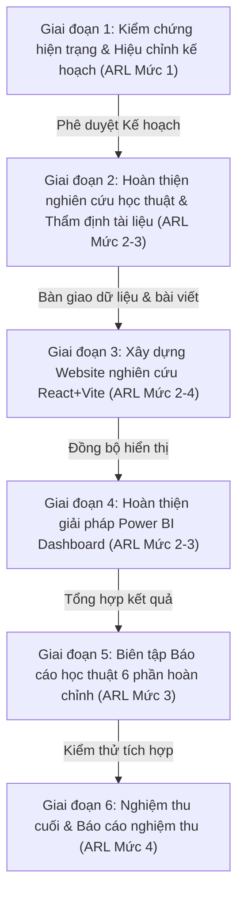

# KẾ HOẠCH TRIỂN KHAI TOÀN DIỆN DỰ ÁN GLOBAL THEO DÀN Ý NGHIÊN CỨU 6 PHẦN
## (Master Implementation Plan — Outline Compliance & Execution — Calibrated v2.0)

- **Tên đề tài chính thức:** *"Khai phá đặc trưng hành vi và tối ưu lựa chọn đặc trưng bằng PSO cho bài toán dự đoán khả năng mua hàng trong thương mại điện tử."*
- **Tài liệu căn cứ tối cao:** [DanY6Phan.md](file:///d:/HuyD/Đại Học/BigData/Global/DanY6Phan.md) (Dàn ý nghiên cứu gốc 6 phần)
- **Tài liệu tham chiếu:** [OUTLINE_COMPLIANCE_AUDIT.md](file:///d:/HuyD/Đại Học/BigData/Global/docs/OUTLINE_COMPLIANCE_AUDIT.md), [PRD.md](file:///d:/HuyD/Đại Học/BigData/Global/PRD.md), [AGENTS.md](file:///d:/HuyD/Đại Học/BigData/Global/AGENTS.md), [DECISIONS.md](file:///d:/HuyD/Đại Học/BigData/Global/docs/DECISIONS.md)
- **Ngày hiệu chỉnh:** 2026-10-12
- **Phiên bản:** v2.0 — Hiệu chỉnh khoa học trước phê duyệt Giai đoạn 1

---

## MỤC LỤC
1. [Hiệu chỉnh khoa học các nhận định kiểm toán](#1-hiệu-chỉnh-khoa-học-các-nhận-định-kiểm-toán)
2. [Hệ thống 4 cấp độ sẵn sàng & Tiêu chuẩn phân loại trạng thái](#2-hệ-thống-4-cấp-độ-sẵn-sàng--tiêu-chuẩn-phân-loại-trạng-thái)
3. [Ma trận phân công 4 thành viên (RACI Matrix)](#3-ma-trận-phân-công-4-thành-viên-raci-matrix)
4. [Bảng kế hoạch chi tiết đối chiếu từng mục theo Dàn ý 6 phần](#4-bảng-kế-hoạch-chi-tiết-đối-chiếu-từng-mục-theo-dàn-ý-6-phần)
   - [Phần 1: Giới thiệu nghiên cứu](#phần-1-giới-thiệu-nghiên-cứu)
   - [Phần 2: Câu hỏi và phương pháp nghiên cứu](#phần-2-câu-hỏi-và-phương-pháp-nghiên-cứu)
   - [Phần 3: Xử lý dữ liệu và phân tích khám phá (EDA)](#phần-3-xử-lý-dữ-liệu-và-phân-tích-khám-phá-eda)
   - [Phần 4: Machine Learning và tối ưu lựa chọn đặc trưng](#phần-4-machine-learning-và-tối-ưu-lựa-chọn-đặc-trưng)
   - [Phần 5: Xây dựng Dashboard và Website trình bày kết quả](#phần-5-xây-dựng-dashboard-và-website-trình-bày-kết-quả)
   - [Phần 6: Hạn chế, hướng phát triển và kết luận](#phần-6-hạn-chế-hướng-phát-triển-và-kết-luận)
5. [Quy chuẩn kiểm chứng cho các hạng mục trọng điểm](#5-quy-chuẩn-kiểm-chứng-cho-các-hạng-mục-trọng-điểm)
   - [5.1. So sánh thực nghiệm PSO vs ANOVA vs Full Features](#51-so-sánh-thực-nghiệm-pso-vs-anova-vs-full-features)
   - [5.2. Tiêu chí phân tích lỗi định tính FP/FN trên tập Holdout](#52-tiêu-chí-phân-tích-lỗi-định-tính-fpfn-trên-tập-holdout)
   - [5.3. Tiêu chuẩn thẩm định 25 tài liệu học thuật (2021–2026)](#53-tiêu-chuẩn-thẩm-định-25-tài-liệu-học-thuật-20212026)
   - [5.4. Phân lập giải pháp Power BI Dashboard và Website React + Vite](#54-phân-lập-giải-pháp-power-bi-dashboard-và-website-react--vite)
6. [Lộ trình 6 giai đoạn & Tiêu chí nghiệm thu tổng thể đã hiệu chỉnh](#6-lộ-trình-6-giai-đoạn--tiêu-chí-nghiệm-thu-tổng-thể-đã-hiệu-chỉnh)

---

## 1. Hiệu chỉnh khoa học các nhận định kiểm toán

Sau khi rà soát độc lập và đối chiếu với các nguyên tắc nghiên cứu, các nhận định kiểm toán được chuẩn hóa lại như sau:

### 1.1. Bác bỏ tuyên bố tuyệt đối về rò rỉ dữ liệu (Anti-Leakage Calibration)
- **Tuyên bố cũ:** Từng kết luận quy trình đạt *"Leakage-Free Protocol"* và *"đã triệt tiêu 100% Cross-Split Data Leakage"*.
- **Hiệu chỉnh khoa học:**
  1. **Cross-Split Data Leakage:** Đạt mức kiểm chứng thực nghiệm trong phạm vi pipeline Scikit-Learn và [split_manager.py](file:///d:/HuyD/Đại Học/BigData/Global/src/models/split_manager.py) hiện có. Cụ thể: các bộ biến đổi (`StandardScaler`, `SimpleImputer`, `OneHotEncoder`, `SelectKBest`) chỉ được `fit` trên 128,000 dòng của tập Train pool; kiểm tra `split_indices.npz` cho thấy tập Train (128k) và Holdout (32k) không trùng lặp chỉ số dòng (`test_split_consistency_and_holdout_isolation` PASS). Tuy nhiên, kết luận này có giới hạn trong phạm vi các bước tiền xử lý đã mã hóa trong pipeline hiện hành, không khái quát thành tuyên bố tuyệt đối vượt ngoài mã nguồn kiểm chứng.
  2. **Temporal Leakage:** **CHƯA THỂ LOẠI TRỪ**. Việc `target` không tương quan tuyến tính với số giao dịch trong 30 ngày cuối ($p > 0.05$) chỉ chứng minh target không được tính đơn thuần từ số lượng giao dịch 30 ngày cuối. Do bộ dữ liệu Kaggle là ảnh chụp quan sát đa bảng tĩnh không cung cấp mốc thời gian cắt dự đoán (Prediction Cutoff Timestamp), các biến đặc trưng tích lũy toàn thời gian (Lifetime aggregations như tổng chi tiêu, tổng số phiên) vẫn tiềm ẩn rủi ro chứa thông tin phát sinh sau thời điểm nhãn được xác định nếu nhãn được gán trong quá khứ.
  3. **Định vị bài toán chuẩn xác:** Bắt buộc sử dụng thuật ngữ: **"Phân loại độ nghiêng mua hàng trên ảnh chụp dữ liệu quan sát đa bảng (Observational Snapshot Purchase Propensity Classification)"**. Tuyệt đối không tuyên bố là bài toán dự báo tương lai 30 ngày đã chứng minh phi rò rỉ thời gian.

### 1.2. Thừa nhận trung thực kết quả so sánh PSO vs ANOVA vs Full Features
- Báo cáo số liệu thực nghiệm gốc đã kiểm chứng trên tập Holdout 32,000 khách hàng (ngưỡng cố định 0.5):
  - **Baseline Gradient Boosting:**
    - *Full Features (63 biến):* PR-AUC = `0.2730`, ROC-AUC = `0.6078`, Fit time = `16.96s`, Search time = `0.0s`, Tổng chi phí = `16.96s`.
    - *Statistical ANOVA F-test (17 biến):* PR-AUC = `0.2759`, ROC-AUC = `0.6105`, Fit time = `6.35s`, Search time = `0.13s`, Tổng chi phí = `6.48s`.
    - *Binary PSO (17 biến):* PR-AUC = `0.2601`, ROC-AUC = `0.5894`, Fit time = `4.52s`, Search time = `11.79s`, Tổng chi phí = `16.31s`.
  - **XGBoost nâng cao:**
    - *XGBoost Full (63 biến):* PR-AUC = `0.2654`, ROC-AUC = `0.6006`, Fit time = `4.65s`, Search time = `0.0s`, Tổng chi phí = `4.65s`.
    - *XGBoost PSO (17 biến):* PR-AUC = `0.2584`, ROC-AUC = `0.5846`, Fit time = `2.22s`, Search time = `11.79s`, Tổng chi phí = `14.01s`.
- **Kết luận khoa học bắt buộc:**
  - **PSO KHÔNG vượt trội ANOVA F-test hoặc Full Features về chất lượng dự đoán (PR-AUC, ROC-AUC) trên bộ dữ liệu này.** Cụ thể, ANOVA đạt PR-AUC cao nhất (`0.2759`), vượt qua cả Full Features (`0.2730`) và PSO (`0.2601`), đồng thời chi phí tìm kiếm của ANOVA cực thấp (`0.13s` so với `11.79s` của PSO).
  - Giá trị thực tế của PSO nằm ở khả năng **giảm 73.02% số chiều đặc trưng** (từ 63 xuống 17 biến) và **giảm hơn 50% thời gian huấn luyện mô hình hạ nguồn** (từ 4.65s xuống 2.22s đối với XGBoost), nhưng phải trả chi phí tìm kiếm ban đầu (`11.79s`, 208 lần đánh giá) và chấp nhận sụt giảm nhẹ PR-AUC (`-0.0070` trên XGBoost, `-0.0129` trên Gradient Boosting).

---

## 2. Hệ thống 4 cấp độ sẵn sàng & Tiêu chuẩn phân loại trạng thái

Để tránh tình trạng "đánh dấu hoàn thành một phần báo cáo chỉ vì đã có mã nguồn hoặc số liệu CSV", kế hoạch áp dụng **Hệ thống 4 cấp độ sẵn sàng (Artifact Readiness Levels - ARL)**:

1. **Mức 1 — Sẵn sàng cấu trúc & Kế hoạch (Plan & Schema):** Đã phân rã mục tiêu, ánh xạ đề mục, có schema dữ liệu và kịch bản thực hiện.
2. **Mức 2 — Sẵn sàng Artifact kỹ thuật (Technical Artifacts):** Đã có mã nguồn, dữ liệu Parquet/CSV, mô hình, biểu đồ hoặc số liệu metrics được xuất ra đĩa.
3. **Mức 3 — Sẵn sàng Nội dung học thuật (Academic Narrative Draft):** Đã viết hoàn chỉnh nội dung bài báo khoa học bằng văn bản trong `docs/report/`, có lập luận, bảng biểu, trích dẫn tài liệu tham khảo và phân tích giới hạn.
4. **Mức 4 — Kiểm chứng độc lập & Nghiệm thu (Verified & Tested):** Đã vượt qua kiểm thử tự động, kiểm toán đối chiếu chéo (cross-audit) và xác nhận tính tái lập.

### Quy tắc gán nhãn trạng thái trong Kế hoạch:
- **Đã hoàn thành:** Hạng mục đã đạt trọn vẹn cả 4 mức (hoặc đạt Mức 2 và Mức 4 đối với hạng mục kỹ thuật thuần túy).
- **Hoàn thành một phần (Kỹ thuật Mức 2, Thiếu học thuật Mức 3):** Đã có code/số liệu/biểu đồ thực tế, nhưng văn bản báo cáo học thuật trong `docs/report/` chưa được viết.
- **Hoàn thành một phần (Thiếu thành phần giao diện/file cụ thể):** Ví dụ đã có dữ liệu CSV cho Power BI nhưng chưa có file `.pbix`.
- **Chưa thực hiện:** Chưa có bất kỳ artifact nào (cả kỹ thuật lẫn văn bản).
- **Chưa xác minh:** Dữ liệu hoặc giả thuyết hiện tại chưa đủ căn cứ để kết luận (ví dụ: mốc thời gian cắt dự đoán).

---

## 3. Ma trận phân công 4 thành viên (RACI Matrix)

Bám sát quy định phân công gốc trong [DanY6Phan.md](file:///d:/HuyD/Đại Học/BigData/Global/DanY6Phan.md):

- **Người 1 (Data Engineer & Pipeline Lead):**
  - Chịu trách nhiệm chính (R) toàn bộ mã nguồn DuckDB, Data Cleaning, Feature Engineering, Split Manager, Huấn luyện 7 mô hình, Thuật toán PSO, Pipeline XGBoost, xuất dữ liệu và kiểm thử tự động `pytest`.
- **Người 2 (Domain Specialist & Research Lead):**
  - Chịu trách nhiệm chính (R) Phần 1 (Giới thiệu), Phần 2 (Câu hỏi, Giả thuyết, Phương pháp), Thẩm định 25 bài báo khoa học (Mục 2.7 & 6.6.1), Thuyết minh dữ liệu & EDA (Phần 3), và Đối chiếu mục tiêu nghiên cứu (Phần 6).
- **Người 3 (Machine Learning & Optimization Lead):**
  - Chịu trách nhiệm chính (R) Thiết kế thực nghiệm ML (Mục 4.1), Phân tích kết quả 7 Baselines (Mục 4.2), Thuật toán Binary PSO & Hội tụ (Mục 4.4), Thí nghiệm XGBoost E1–E5 (Mục 4.5), Đánh giá toàn diện & Trade-off (Mục 4.6, 4.8), và Phân tích lỗi định tính FP/FN trên tập Holdout (Mục 4.7).
- **Người 4 (Product, Visualization & Synthesis Lead):**
  - Chịu trách nhiệm chính (R) Giải pháp Power BI Dashboard 4 trang (Mục 5.2, 5.3), Website nghiên cứu React+Vite (Mục 5.4, 5.5, 5.6), Tổng hợp phát hiện & Hàm ý kinh doanh (Mục 5.7), Biên tập tổng hợp kết luận và báo cáo 6 phần hoàn chỉnh (Phần 6).

---

## 4. Bảng kế hoạch chi tiết đối chiếu từng mục theo Dàn ý 6 phần

### Phần 1: Giới thiệu nghiên cứu

| Mã CV | Mục DanY6Phan | Hiện trạng & Bằng chứng thực tế | Việc cần làm | File đầu ra | Người phụ trách | Phụ thuộc | Tiêu chí nghiệm thu chi tiết | Mức ưu tiên |
| :--- | :--- | :--- | :--- | :--- | :---: | :--- | :--- | :---: |
| **TSK-1.1** | 1.1 Bối cảnh nghiên cứu (1.1.1–1.1.4) | **Hoàn thành một phần** Mức 1 & 2 (Có tóm tắt trong [PRD.md:L7-L9](file:///d:/HuyD/Đại Học/BigData/Global/PRD.md#L7-L9)); Thiếu Mức 3 | Viết văn bản học thuật 2–3 trang: xu hướng TMĐT, vai trò dữ liệu, thách thức đa bảng, dẫn vào đề tài; kèm 2–3 số liệu thị trường có trích dẫn nguồn uy tín. | `docs/report/Phan_1.md` (Mục 1.1) | **Người 2** (Chính) Người 1 (C) | TSK-2.7 (Tài liệu tham khảo) | Bài viết 2–3 trang, lập luận chặt chẽ, có trích dẫn nguồn, phân biệt phân tích mô tả vs dự đoán; không suy diễn hiệu quả marketing. | **Cao** |
| **TSK-1.2** | 1.2 Vấn đề nghiên cứu (1.2.1–1.2.4) | **Hoàn thành một phần** Mức 1 & 2 (Đã phát biểu trong [PRD.md:L12](file:///d:/HuyD/Đại Học/BigData/Global/PRD.md#L12) & [DECISIONS.md](file:///d:/HuyD/Đại Học/BigData/Global/docs/DECISIONS.md)); Thiếu Mức 3 | Trình bày 4 nội dung: Vấn đề thực tiễn, vấn đề kỹ thuật, khoảng trống nghiên cứu và chốt phát biểu câu hỏi nghiên cứu trung tâm. | `docs/report/Phan_1.md` (Mục 1.2) | **Người 2** (Chính) Người 3 (C) | TSK-1.1 | Nêu rõ câu hỏi trung tâm về hiệu quả của PSO trong điều kiện tính toán giới hạn; không tuyên bố "chưa có ai làm" khi chưa rà soát. | **Cao** |
| **TSK-1.3** | 1.3 Giới thiệu bộ dữ liệu (1.3.1–1.3.4) | **Hoàn thành một phần** Mức 2 & 4 ([inspect_data.py](file:///d:/HuyD/Đại Học/BigData/Global/src/data/inspect_data.py), [DATA_DICTIONARY.md](file:///d:/HuyD/Đại Học/BigData/Global/docs/DATA_DICTIONARY.md)); Thiếu Mức 3 | Soạn thảo văn bản học thuật: nguồn Kaggle, quy mô 8 file, sơ đồ quan hệ khóa, kiểm toán target 20.3% và cảnh báo giới hạn mốc thời gian snapshot. | `docs/report/Phan_1.md` (Mục 1.3) | **Người 2** (Chính) Người 1 (C) | Pipeline kiểm toán dữ liệu | Đủ bảng 8 file (2M sessions, 500k trans, 200k cust, 160k train, 40k test), sơ đồ quan hệ, ghi rõ giới hạn snapshot không mốc cutoff. | **Cao** |
| **TSK-1.4** | 1.4 Lý do lựa chọn đề tài và dataset | **Hoàn thành một phần** Mức 1 & 2 ([PRD.md:L24-L36](file:///d:/HuyD/Đại Học/BigData/Global/PRD.md#L24-L36) & [DECISIONS.md](file:///d:/HuyD/Đại Học/BigData/Global/docs/DECISIONS.md)); Thiếu Mức 3 | Biên tập thành văn bản học thuật 1–1.5 trang phân tích sâu 6 khía cạnh: TMĐT, Big Data, Machine Learning, PSO, Khả thi DuckDB, Phát triển sản phẩm. | `docs/report/Phan_1.md` (Mục 1.4) | **Người 2** (Chính) Người 1 (C) | TSK-1.3 | Lập luận sắc bén, làm rõ tính phù hợp giữa năng lực DuckDB/PSO với quy mô máy đơn; tránh chỉ liệt kê dataset lớn. | **Trung bình** |
| **TSK-1.5** | 1.5 Mục tiêu nghiên cứu (1.5.1–1.5.2) | **Hoàn thành một phần** Mức 1 & 2 ([PRD.md:L12-L21](file:///d:/HuyD/Đại Học/BigData/Global/PRD.md#L12-L21)); Thiếu Mức 3 | Trình bày mục tiêu tổng quát và 7 mục tiêu cụ thể, mỗi mục tiêu gắn với 1 sản phẩm đầu ra có thể nghiệm thu. | `docs/report/Phan_1.md` (Mục 1.5) | **Người 2** (Chính) Người 3, 4 (C) | PRD.md | Đúng nguyên văn 7 mục tiêu trong DanY6Phan.md; có bảng đối chiếu đầu ra kiểm tra được. | **Cao** |
| **TSK-1.6** | 1.6 Đối tượng, phạm vi và giới hạn | **Hoàn thành một phần** Mức 1 & 2 ([DATA_DICTIONARY.md](file:///d:/HuyD/Đại Học/BigData/Global/docs/DATA_DICTIONARY.md) & [PRD.md](file:///d:/HuyD/Đại Học/BigData/Global/PRD.md)); Thiếu Mức 3 | Biên tập văn bản học thuật nêu 4 khía cạnh: Đối tượng nghiên cứu, phạm vi dữ liệu, phạm vi kỹ thuật và giới hạn dự kiến (đặc biệt là hạn chế temporal snapshot). | `docs/report/Phan_1.md` (Mục 1.6) | **Người 2** (Chính) Người 1 (C) | TSK-1.3 | Ghi rõ giới hạn dữ liệu thứ cấp, không suy diễn nhân quả, không tuyên bố dự báo tương lai 30 ngày. | **Cao** |
| **TSK-1.7** | 1.7 Đóng góp dự kiến và điểm khác biệt | **Hoàn thành một phần** Mức 1 & 2 ([README.md:L13-L40](file:///d:/HuyD/Đại Học/BigData/Global/README.md#L13-L40) & [EXPERIMENT_PLAN.md](file:///d:/HuyD/Đại Học/BigData/Global/docs/EXPERIMENT_PLAN.md)); Thiếu Mức 3 | Trình bày 3 khía cạnh đóng góp: Phương pháp (đa bảng + đa mục tiêu), Thực nghiệm (so sánh công bằng 7 mô hình + PSO trade-off), Ứng dụng (Dashboard + Web). | `docs/report/Phan_1.md` (Mục 1.7) | **Người 2** (Chính) Người 3, 4 (C) | TSK-1.2 | Không tuyên bố PSO là mới; nhấn mạnh điểm khác biệt ở quy trình đánh giá thực nghiệm trung thực. | **Trung bình** |
| **TSK-1.8** | 1.8 Bố cục báo cáo | **Hoàn thành một phần** Mức 1 & 2 ([README.md](file:///d:/HuyD/Đại Học/BigData/Global/README.md)); Thiếu Mức 3 | Viết tóm tắt cấu trúc 6 phần chính, danh mục tài liệu tham khảo và phụ lục. | `docs/report/Phan_1.md` (Mục 1.8) | **Người 2** (Chính) Cả nhóm (C) | DanY6Phan.md | Tóm tắt đúng trình tự và logic của 6 phần nghiên cứu. | **Thấp** |

---

### Phần 2: Câu hỏi và phương pháp nghiên cứu

| Mã CV | Mục DanY6Phan | Hiện trạng & Bằng chứng thực tế | Việc cần làm | File đầu ra | Người phụ trách | Phụ thuộc | Tiêu chí nghiệm thu chi tiết | Mức ưu tiên |
| :--- | :--- | :--- | :--- | :--- | :---: | :--- | :--- | :---: |
| **TSK-2.1** | 2.1 Mục tiêu và định hướng nghiên cứu | **Hoàn thành một phần** Mức 1 & 2 (Khớp với Phần 1.5 và [EXPERIMENT_PLAN.md](file:///d:/HuyD/Đại Học/BigData/Global/docs/EXPERIMENT_PLAN.md)); Thiếu Mức 3 | Viết văn bản chi tiết làm rõ mối quan hệ giữa Feature Engineering, Feature Selection và hiệu năng dự đoán trên dataset. | `docs/report/Phan_2.md` (Mục 2.1) | **Người 2** (Chính) Người 1 (C) | TSK-1.5 | Thiết lập định hướng rõ ràng cho pipeline ML ở Phần 3 & 4. | **Cao** |
| **TSK-2.2** | 2.2 5 Câu hỏi nghiên cứu (RQ1–RQ5) | **Hoàn thành một phần** Mức 2 (Đã có code/kết quả thực nghiệm cho RQ1–RQ4); Thiếu Mức 3 & RQ5 | Biên tập văn bản học thuật trình bày chi tiết nội dung, phương pháp trả lời và sản phẩm đầu ra tương ứng cho từng câu hỏi RQ1 đến RQ5. | `docs/report/Phan_2.md` (Mục 2.2) | **Người 2** (Chính) Người 3, 4 (C) | TSK-2.1 | Đầy đủ 5 RQ: RQ1 (Đặc trưng), RQ2 (Mô hình cơ sở), RQ3 (PSO vs Thống kê), RQ4 (Mô hình nâng cao & trade-off), RQ5 (Ứng dụng). | **Cao** |
| **TSK-2.3** | 2.3 4 Giả thuyết nghiên cứu (H1–H4) | **Hoàn thành một phần** Mức 2 & 4 (Đã kiểm chứng số liệu trong [metrics_comparison.csv](file:///d:/HuyD/Đại Học/BigData/Global/outputs/metrics/metrics_comparison.csv)); Thiếu Mức 3 | Trình bày phát biểu 4 giả thuyết H1–H4, cách thức kiểm chứng và nguyên tắc báo cáo trung thực nếu kết quả không ủng hộ hoàn toàn giả thuyết. | `docs/report/Phan_2.md` (Mục 2.3) | **Người 2** (Chính) Người 3 (C) | TSK-2.2 | H1 (Feature enrichment), H2 (Non-linear vs Linear), H3 (PSO sparsity), H4 (Trade-off & efficiency). Báo cáo khách quan H3/H4 có trade-off. | **Cao** |
| **TSK-2.4** | 2.4 Thiết kế nghiên cứu và chia tập | **Hoàn thành một phần** Mức 2 & 4 ([split_manager.py](file:///d:/HuyD/Đại Học/BigData/Global/src/models/split_manager.py), [split_indices.npz](file:///d:/HuyD/Đại Học/BigData/Global/outputs/processed/split_indices.npz)); Thiếu Mức 3 | Trình bày loại hình nghiên cứu, quy trình nghiên cứu, sơ đồ luồng, nguyên tắc chia dữ liệu Stratified 80/20, cô lập 32k Holdout, Fit-on-Train only và kiểm soát chi phí. | `docs/report/Phan_2.md` (Mục 2.4) | **Người 2** (Chính) Người 1, 3 (C) | Pipeline split_manager | Sơ đồ luồng nghiên cứu, bảng tham số phân vùng, chứng minh cô lập Holdout và zero test leakage. | **Cao** |
| **TSK-2.5** | 2.5 Phương pháp xử lý và phân tích | **Hoàn thành một phần** Mức 2 & 4 (Đầy đủ mã nguồn `src/`); Thiếu Mức 3 | Mô tả chi tiết phương pháp: Truy vấn DuckDB, Tiền xử lý, EDA, Huấn luyện mô hình, Thuật toán Binary PSO và Trực quan hóa. | `docs/report/Phan_2.md` (Mục 2.5) | **Người 1** (Cung cấp) **Người 2** (Viết chính) | Mã nguồn pipeline | Mô tả chuẩn xác công nghệ, công thức và nguyên lý vận hành. | **Cao** |
| **TSK-2.6** | 2.6 Tiêu chí đánh giá đa chiều | **Hoàn thành một phần** Mức 2 & 4 ([evaluate.py](file:///d:/HuyD/Đại Học/BigData/Global/src/evaluation/evaluate.py)); Thiếu Mức 3 | Trình bày bảng tiêu chí đánh giá mô hình, tiêu chí đánh giá PSO và tiêu chí đánh giá ứng dụng; giải thích lý do ưu tiên PR-AUC trên dữ liệu mất cân bằng. | `docs/report/Phan_2.md` (Mục 2.6) | **Người 3** (Chính) Người 1, 2 (C) | evaluate.py | Bảng chỉ số hoàn chỉnh, giải thích ý nghĩa từng chỉ số, quy định ngưỡng cố định 0.5. | **Cao** |
| **TSK-2.7** | 2.7 Tổng quan nghiên cứu ($\ge 25$ bài 2021–2026) | **Chưa thực hiện** Chưa có danh mục tài liệu học thuật 2021–2026 | Thu thập, thẩm định 5 tiêu chí và lập bảng đối chiếu tối thiểu 25 bài báo khoa học (2021–2026) theo 4 nhóm chủ đề: Mua hàng TMĐT, Feature Engineering/Selection, PSO Boosting, Đánh giá/Giải thích mô hình. | `docs/report/Phan_2.md` (Mục 2.7) & `docs/LITERATURE_REVIEW.md` | **Người 2** (Điều phối) Người 3, 4 (C) | Tra cứu học thuật | Tối thiểu 25 tài liệu có tác giả, năm, tên bài, nguồn, phương pháp, kết quả, hạn chế và DOI/URL thật có thể kiểm chứng. Nêu rõ nếu thiếu nguồn. | **Cao** |

---

### Phần 3: Xử lý dữ liệu và phân tích khám phá (EDA)

| Mã CV | Mục DanY6Phan | Hiện trạng & Bằng chứng thực tế | Việc cần làm | File đầu ra | Người phụ trách | Phụ thuộc | Tiêu chí nghiệm thu chi tiết | Mức ưu tiên |
| :--- | :--- | :--- | :--- | :--- | :---: | :--- | :--- | :---: |
| **TSK-3.1** | 3.1 Tổng quan dataset (8 tệp CSV) | **Hoàn thành một phần** Mức 2 & 4 ([DATA_DICTIONARY.md](file:///d:/HuyD/Đại Học/BigData/Global/docs/DATA_DICTIONARY.md)); Thiếu Mức 3 | Viết chương báo cáo: thống kê số dòng/cột/dung lượng, phân loại nhóm dữ liệu, vai trò từng bảng và sơ đồ quan hệ ERD. | `docs/report/Phan_3.md` (Mục 3.1) | **Người 2** (Chính) Người 1 (C) | DATA_DICTIONARY.md | Khớp tuyệt đối số dòng thực tế: 2M sessions, 500k transactions, 200k customers, 200 marketing, 100 geo, 160k train, 40k test. | **Cao** |
| **TSK-3.2** | 3.2 Kiểm tra chất lượng dữ liệu | **Hoàn thành một phần** Mức 2 & 4 ([clean_data.py](file:///d:/HuyD/Đại Học/BigData/Global/src/data/clean_data.py), [data_quality_report.csv](file:///d:/HuyD/Đại Học/BigData/Global/outputs/data_quality_report.csv)); Thiếu Mức 3 | Báo cáo chi tiết: tỷ lệ missing, dòng trùng lặp, chuẩn hóa định dạng không nhất quán (USA/US, Boolean 0/FALSE, tiền tệ) và phát hiện ngoại lệ bằng IQR/Boxplot. | `docs/report/Phan_3.md` (Mục 3.2) | **Người 2** (Chính) Người 1 (C) | data_quality_report.csv | Có bảng thống kê lỗi trước và sau làm sạch; diễn giải hợp lý không xóa bừa bãi. | **Cao** |
| **TSK-3.3** | 3.3 Tích hợp đa bảng bằng DuckDB | **Hoàn thành một phần** Mức 2 & 4 ([integrate_data.py](file:///d:/HuyD/Đại Học/BigData/Global/src/data/integrate_data.py), [customer_features.parquet](file:///d:/HuyD/Đại Học/BigData/Global/outputs/customer_features.parquet)); Thiếu Mức 3 | Trình bày quy trình tổng hợp cấp khách hàng: aggregate sessions & transactions trước khi join, tránh bùng nổ Cartesian; báo cáo thời gian thực thi ~6s và số dòng bảo toàn 200,000 khách hàng. | `docs/report/Phan_3.md` (Mục 3.3) | **Người 1** (Cung cấp) **Người 2** (Viết chính) | customer_features.parquet | Sơ đồ pipeline tích hợp, bảng số dòng trước/sau join, kiểm tra tính toàn vẹn khóa. | **Cao** |
| **TSK-3.4** | 3.4 Feature Engineering (67 đặc trưng) | **Hoàn thành một phần** Mức 2 & 4 ([build_features.py](file:///d:/HuyD/Đại Học/BigData/Global/src/features/build_features.py), [feature_dictionary.csv](file:///d:/HuyD/Đại Học/BigData/Global/outputs/feature_dictionary.csv)); Thiếu Mức 3 | Phân tích 6 nhóm đặc trưng hành vi (Khách hàng, Cường độ truy cập, Ý định mua, Lịch sử giao dịch, Marketing, Địa lý). Kiểm tra loại bỏ ID và target; phân lập biến nhiễu. | `docs/report/Phan_3.md` (Mục 3.4) | **Người 2** (Chính) Người 1, 3 (C) | feature_dictionary.csv | Bảng mô tả 67 biến kèm công thức, kiểu dữ liệu, bản chất thời gian và đánh giá rủi ro leakage. | **Cao** |
| **TSK-3.5** | 3.5 Phân tích khám phá dữ liệu (EDA) | **Hoàn thành một phần** Mức 2 (12 biểu đồ PNG [outputs/eda/](file:///d:/HuyD/Đại Học/BigData/Global/outputs/eda), [eda_customer_summary.csv](file:///d:/HuyD/Đại Học/BigData/Global/outputs/eda_customer_summary.csv)); Thiếu Mức 3 | Trình bày và diễn giải 12 biểu đồ EDA: phân phối target (20.3%), đặc điểm khách hàng, hành vi phiên truy cập, lịch sử giao dịch và tương quan biến. Rút ra 5–10 phát hiện chính có số liệu chứng minh. | `docs/report/Phan_3.md` (Mục 3.5) | **Người 2** (Chính) Người 1 (C) | 12 biểu đồ outputs/eda/ | Đầy đủ 12 hình ảnh, chú thích rõ ràng, diễn giải định lượng, không quy kết quan hệ nhân quả. | **Cao** |
| **TSK-3.6** | 3.6 Chuẩn bị dữ liệu cho ML (Fit-on-Train) | **Hoàn thành một phần** Mức 2 & 4 ([split_manager.py](file:///d:/HuyD/Đại Học/BigData/Global/src/models/split_manager.py), [split_metadata.json](file:///d:/HuyD/Đại Học/BigData/Global/configs/split_metadata.json)); Thiếu Mức 3 | Mô tả quy trình tách X/y, pipeline tiền xử lý (Imputer, Scaler, Encoder), phân vùng Stratified 80/20, cô lập hoàn toàn 32k Holdout và fit bộ tiền xử lý strictly trên Train. | `docs/report/Phan_3.md` (Mục 3.6) | **Người 1** (Cung cấp) **Người 2** (Viết chính) | split_manager.py | Bảng phân vùng dữ liệu, bằng chứng zero cross-split leakage trong unit test, xác nhận target không lọt vào X. | **Cao** |
| **TSK-3.7** | 3.7 Tổng hợp phát hiện EDA & chuyển tiếp | **Hoàn thành một phần** Mức 1 & 2 (Có trong README.md); Thiếu Mức 3 | Viết phần tổng hợp đúc kết các phát hiện EDA, nhấn mạnh các đặc trưng hành vi tiềm năng và các câu hỏi cần kiểm chứng bằng Machine Learning ở Phần 4. | `docs/report/Phan_3.md` (Mục 3.7) | **Người 2** (Chính) Người 3 (C) | TSK-3.5 | Cầu nối logic chặt chẽ từ EDA sang thiết kế mô hình Machine Learning. | **Trung bình** |

---

### Phần 4: Machine Learning và tối ưu lựa chọn đặc trưng

| Mã CV | Mục DanY6Phan | Hiện trạng & Bằng chứng thực tế | Việc cần làm | File đầu ra | Người phụ trách | Phụ thuộc | Tiêu chí nghiệm thu chi tiết | Mức ưu tiên |
| :--- | :--- | :--- | :--- | :--- | :---: | :--- | :--- | :---: |
| **TSK-4.1** | 4.1 Thiết kế thực nghiệm ML so sánh công bằng | **Hoàn thành một phần** Mức 2 & 4 ([EXPERIMENT_PLAN.md](file:///d:/HuyD/Đại Học/BigData/Global/docs/EXPERIMENT_PLAN.md), [split_manager.py](file:///d:/HuyD/Đại Học/BigData/Global/src/models/split_manager.py)); Thiếu Mức 3 | Mô tả thiết kế so sánh công bằng: cùng phân vùng `stratified_80_20_v1`, cùng ngưỡng cố định 0.5, cùng seed 42, cùng tập đánh giá Holdout 32k; sơ đồ 4 nhánh A, B, C, D. | `docs/report/Phan_4.md` (Mục 4.1) | **Người 3** (Chính) Người 1 (C) | EXPERIMENT_PLAN.md | Sơ đồ luồng thực nghiệm, thông số môi trường tái lập, nguyên tắc chống thiên vị. | **Cao** |
| **TSK-4.2** | 4.2 Huấn luyện & đánh giá 7 mô hình cơ sở | **Hoàn thành một phần** Mức 2 & 4 ([baselines.py](file:///d:/HuyD/Đại Học/BigData/Global/src/models/baselines.py), [baseline_metrics.csv](file:///d:/HuyD/Đại Học/BigData/Global/outputs/metrics/baseline_metrics.csv)); Thiếu Mức 3 | Báo cáo chi tiết hiệu năng 7 mô hình: GB, RF, LR, SGDClassifier (linear SVM), DT, NB, KNN. Phân tích ROC-AUC, PR-AUC, F1, Runtime và chọn GB làm mô hình cơ sở tốt nhất. Giải thích lựa chọn SGDClassifier cho SVM. | `docs/report/Phan_4.md` (Mục 4.2) | **Người 3** (Chính) Người 1 (C) | baseline_metrics.csv | Bảng so sánh 7 mô hình đầy đủ 9 chỉ số; biểu đồ cột so sánh ROC-AUC/PR-AUC; phân tích điểm mạnh/yếu; chú thích 180 chiều One-Hot. | **Cao** |
| **TSK-4.3** | 4.3 So sánh 3 phương án lựa chọn đặc trưng | **Hoàn thành một phần** Mức 2 & 4 ([feature_selection.py](file:///d:/HuyD/Đại Học/BigData/Global/src/models/feature_selection.py), [feature_selection_comparison.csv](file:///d:/HuyD/Đại Học/BigData/Global/outputs/metrics/feature_selection_comparison.csv)); Thiếu Mức 3 | Phân tích đối chứng tại cùng k=17 biến: Phương án A (Full 63 biến), Phương án B (ANOVA F-test 17 biến), Phương án C (Binary PSO 17 biến). Báo cáo riêng PR-AUC, ROC-AUC, thời gian tìm kiếm, thời gian huấn luyện và tổng chi phí. | `docs/report/Phan_4.md` (Mục 4.3) | **Người 3** (Chính) Người 1 (C) | feature_selection_comparison.csv | Báo cáo trung thực ANOVA vượt trội PR-AUC/ROC-AUC và tiết kiệm chi phí; PSO giảm chiều nhưng không cải thiện chất lượng dự đoán. | **Cao** |
| **TSK-4.4** | 4.4 Triển khai & đánh giá Binary PSO | **Hoàn thành một phần** Mức 2 & 4 ([pso_optimizer.py](file:///d:/HuyD/Đại Học/BigData/Global/src/models/pso_optimizer.py), [pso_selected_features.csv](file:///d:/HuyD/Đại Học/BigData/Global/outputs/feature_selection/pso_selected_features.csv), [pso_convergence.png](file:///d:/HuyD/Đại Học/BigData/Global/outputs/plots/pso_convergence.png)); Thiếu Mức 3 | Trình bày nguyên lý Binary PSO, hàm mục tiêu đa tiêu chí ($0.92 \cdot \text{PR-AUC} + 0.08 \cdot \text{Sparsity}$), cấu hình (16 hạt, 12 vòng lặp), cache đánh giá (208 evaluations), đường hội tụ và danh sách 17 đặc trưng được chọn. | `docs/report/Phan_4.md` (Mục 4.4) | **Người 3** (Chính) Người 1 (C) | pso_experiment_config.json | Công thức hàm fitness, biểu đồ hội tụ pso_convergence.png, bảng danh sách 17 biến, báo cáo search cost 11.79s tách biệt fit time. | **Cao** |
| **TSK-4.5** | 4.5 Mô hình nâng cao XGBoost & Thí nghiệm E1–E5 | **Hoàn thành một phần** Mức 2 & 4 ([train_xgboost.py](file:///d:/HuyD/Đại Học/BigData/Global/src/models/train_xgboost.py), [metrics_comparison.csv](file:///d:/HuyD/Đại Học/BigData/Global/outputs/metrics/metrics_comparison.csv)); Thiếu Mức 3 | Báo cáo chi tiết ma trận 5 thí nghiệm E1 (Baseline Full), E2 (Baseline ANOVA), E3 (Baseline PSO), E4 (XGBoost Full), E5 (XGBoost PSO). Phân tích riêng rẽ tác động của bộ đặc trưng vs tác động của thuật toán boosting. | `docs/report/Phan_4.md` (Mục 4.5) | **Người 3** (Chính) Người 1 (C) | metrics_comparison.csv | Bảng tổng hợp E1–E5 đầy đủ PR-AUC, ROC-AUC, Search time, Fit time; phân tích độ quan trọng của đặc trưng XGBoost. | **Cao** |
| **TSK-4.6** | 4.6 Đánh giá hiệu quả mô hình toàn diện | **Hoàn thành một phần** Mức 2 & 4 ([roc_curve.png](file:///d:/HuyD/Đại Học/BigData/Global/outputs/plots/roc_curve.png), [precision_recall_curve.png](file:///d:/HuyD/Đại Học/BigData/Global/outputs/plots/precision_recall_curve.png), [confusion_matrix.png](file:///d:/HuyD/Đại Học/BigData/Global/outputs/plots/confusion_matrix.png)); Thiếu Mức 3 | Phân tích toàn diện: đường cong ROC, đường cong PR, ma trận nhầm lẫn của XGBoost E4 và E5. Thảo luận về việc lựa chọn ngưỡng phân loại cố định 0.5 vs ngưỡng tối ưu F1 tham chiếu. | `docs/report/Phan_4.md` (Mục 4.6) | **Người 3** (Chính) Người 1, 2 (C) | Các biểu đồ trong outputs/plots/ | Nhúng đầy đủ 3 biểu đồ hiệu năng, phân tích trade-off giữa Precision và Recall trên tập Holdout 32k. | **Cao** |
| **TSK-4.7** | 4.7 Phân tích lỗi định tính (FP/FN) & giải thích | **Hoàn thành một phần** Mức 2 (Có số đếm TP/FP/TN/FN); Thiếu Mức 3 (Chưa có phân tích định tính) | Phân tích định tính hồ sơ khách hàng của các ca False Positive và False Negative dựa trên dữ liệu Holdout 32k thực tế; thống kê đặc trưng phân vị; không bịa hồ sơ cá nhân; không suy diễn nhân quả. | `docs/report/Phan_4.md` (Mục 4.7) & `docs/ERROR_ANALYSIS.md` | **Người 3** (Chính) Người 4 (C) | Confusion matrix & feature_importance.csv | Bảng thống kê phân vị đặc trưng TP vs FP vs TN vs FN thực tế, diễn giải nguyên nhân sai lệch dưới góc độ hành vi TMĐT có kiểm chứng. | **Cao** |
| **TSK-4.8** | 4.8 Thảo luận kết quả & đối chiếu RQ/H | **Hoàn thành một phần** Mức 1 & 2 ([EXPERIMENT_PLAN.md](file:///d:/HuyD/Đại Học/BigData/Global/docs/EXPERIMENT_PLAN.md), [README.md](file:///d:/HuyD/Đại Học/BigData/Global/README.md)); Thiếu Mức 3 | Trả lời trực tiếp 5 câu hỏi nghiên cứu RQ1–RQ5 và 4 giả thuyết H1–H4. Thảo luận trung thực bản chất trade-off: PSO giảm mạnh số chiều và tăng tốc độ suy luận hạ nguồn nhưng có chi phí tìm kiếm ban đầu. | `docs/report/Phan_4.md` (Mục 4.8) | **Người 3** (Chính) Người 2 (C) | metrics_comparison.csv | Trả lời rõ ràng, có căn cứ số liệu cho từng RQ và H; không né tránh kết quả trade-off. | **Cao** |

---

### Phần 5: Xây dựng Dashboard và Website trình bày kết quả

| Mã CV | Mục DanY6Phan | Hiện trạng & Bằng chứng thực tế | Việc cần làm | File đầu ra | Người phụ trách | Phụ thuộc | Tiêu chí nghiệm thu chi tiết | Mức ưu tiên |
| :--- | :--- | :--- | :--- | :--- | :---: | :--- | :--- | :---: |
| **TSK-5.1** | 5.1 Mục tiêu & yêu cầu thiết kế Dashboard/Web | **Hoàn thành một phần** Mức 1 & 2 ([PRD.md:L48](file:///d:/HuyD/Đại Học/BigData/Global/PRD.md#L48)); Thiếu Mức 3 | Xây dựng tài liệu đặc tả yêu cầu: đối tượng người dùng, yêu cầu hiển thị, tính truy xuất số liệu, bộ lọc tương tác, phân biệt giữa dự đoán mô hình vs cam kết thực tế. | `docs/report/Phan_5.md` (Mục 5.1) | **Người 4** (Chính) Người 1 (C) | DanY6Phan.md | Bản đặc tả chi tiết giao diện và luồng trải nghiệm người dùng; tách bạch rõ ràng giữa Website và Power BI. | **Trung bình** |
| **TSK-5.2** | 5.2 Xây dựng Power BI Dashboard 4 trang | **Hoàn thành một phần** Mức 2 (7 CSV sẵn sàng trong `outputs/powerbi/`); Thiếu file `.pbix` | Thiết kế tài liệu kỹ thuật chi tiết từng visual, layout, bộ lọc và công thức DAX cho 4 trang (Tổng quan TMĐT, Phân tích hành vi, So sánh mô hình ML, Hàm ý kinh doanh). Cung cấp hướng dẫn thao tác thủ công trong Power BI Desktop để tạo file `.pbix`. | `outputs/powerbi/POWER_BI_DESIGN_GUIDE.md` & `outputs/powerbi/global_ecommerce_dashboard.pbix` (manual build) | **Người 4** (Chính) Người 1 (C) | TSK-5.3 | Đầy đủ cấu trúc 4 trang, công thức DAX measures kiểm tra khớp số liệu Python, quy trình 5 bước để tạo `.pbix` thủ công. | **Cao** |
| **TSK-5.3** | 5.3 Chuẩn bị dữ liệu cho Power BI | **Hoàn thành một phần** Mức 2 & 4 (7 CSV đã xuất); Thiếu tài liệu schema | Kiểm tra tính toàn vẹn khóa, định dạng kiểu dữ liệu và xây dựng tài liệu mô tả data model (Star schema) giữa các bảng phục vụ kết nối Power BI. | `outputs/powerbi/DATA_MODEL_SCHEMA.md` & `docs/report/Phan_5.md` (Mục 5.3) | **Người 1** (Cung cấp) **Người 4** (Viết chính) | export_outputs.py | Đầy đủ 7 file CSV sạch, không cần tính toán nặng trong Power BI, tài liệu sơ đồ quan hệ rõ ràng. | **Cao** |
| **TSK-5.4** | 5.4 Xây dựng Website nghiên cứu (React + Vite) | **Chưa thực hiện** Chưa có thư mục `web/` | Xây dựng ứng dụng web hoàn chỉnh bằng React + Vite trong `web/` gồm 6 trang/mục: Overview, Methodology, Experiments, Insights, Demo (suy luận tĩnh/client-side chuẩn), Docs & Reproducibility. | Thư mục `web/` (Source code, components, CSS, assets) | **Người 4** (Chính) Người 1 (C) | Dữ liệu outputs/ & kết quả ML | Giao diện hiện đại, responsive, trực quan hóa biểu đồ tương tác, số liệu khớp 100% với artifacts thực nghiệm. Không thay thế Power BI. | **Cao** |
| **TSK-5.5** | 5.5 Kiến trúc kỹ thuật & triển khai Web/Dashboard | **Hoàn thành một phần** Mức 1; Thiếu Mức 3 | Mô tả chi tiết kiến trúc tách biệt giữa Tầng dữ liệu (DuckDB/Parquet/CSV), Tầng phân tích (Python/ML/PSO) và Tầng hiển thị (React Web & Power BI Desktop). Hướng dẫn cài đặt và build. | `docs/report/Phan_5.md` (Mục 5.5) & `web/README.md` | **Người 4** (Chính) Người 1 (C) | TSK-5.4 | Sơ đồ kiến trúc 3 tầng, hướng dẫn `npm install`, `npm run dev`, `npm run build` rõ ràng. | **Cao** |
| **TSK-5.6** | 5.6 Kiểm thử & đánh giá Dashboard / Website | **Chưa thực hiện** Phụ thuộc vào TSK-5.2 và TSK-5.4 | Thực hiện kiểm thử: đối chiếu KPI hiển thị với số liệu Python, kiểm tra responsive trên mobile/desktop, kiểm tra tương tác biểu đồ, kiểm tra tính đúng đắn của chức năng Demo. | `docs/report/Phan_5.md` (Mục 5.6) & `tests/test_web_and_dashboard_data.py` | **Người 4** (Chính) Cả nhóm (C) | TSK-5.2, TSK-5.4 | Checklist kiểm thử hoàn thành, không có lỗi hiển thị hoặc lệch số liệu. | **Cao** |
| **TSK-5.7** | 5.7 Tổng hợp phát hiện & Hàm ý kinh doanh | **Hoàn thành một phần** Mức 1 & 2; Thiếu Mức 3 | Soạn thảo 3–5 đề xuất hành động kinh doanh theo cấu trúc chuẩn: **Phát hiện → Bằng chứng thực nghiệm → Hàm ý → Hành động đề xuất → Giới hạn/Cảnh báo rủi ro**. | `docs/report/Phan_5.md` (Mục 5.7) | **Người 4** (Chính) Người 2, 3 (C) | TSK-3.5, TSK-4.5 | Đầy đủ 3–5 đề xuất chuẩn cấu trúc, không suy diễn nhân quả hoặc cam kết doanh số vô căn cứ. | **Cao** |

---

### Phần 6: Hạn chế, hướng phát triển và kết luận

| Mã CV | Mục DanY6Phan | Hiện trạng & Bằng chứng thực tế | Việc cần làm | File đầu ra | Người phụ trách | Phụ thuộc | Tiêu chí nghiệm thu chi tiết | Mức ưu tiên |
| :--- | :--- | :--- | :--- | :--- | :---: | :--- | :--- | :---: |
| **TSK-6.1** | 6.1 Tổng kết kết quả nghiên cứu | **Hoàn thành một phần** Mức 2 & 4 ([metrics_comparison.csv](file:///d:/HuyD/Đại Học/BigData/Global/outputs/metrics/metrics_comparison.csv)); Thiếu Mức 3 | Lập bảng tổng kết thực nghiệm toàn diện đối chiếu trước và sau PSO: số biến ban đầu (63) vs sau PSO (17), mô hình cơ sở tốt nhất (GB 0.2758), mô hình PSO+XGBoost (0.2584), thời gian tìm kiếm (11.79s) vs fit (2.22s). | `docs/report/Phan_6.md` (Mục 6.1) | **Người 3** (Cung cấp) **Người 4** (Biên tập chính) | metrics_comparison.csv | Bảng tổng hợp số liệu chuẩn xác từ artifacts, không bịa đặt số liệu; tách riêng fit time và search time. | **Cao** |
| **TSK-6.2** | 6.2 Đánh giá mức độ hoàn thành mục tiêu | **Hoàn thành một phần** Mức 1 & 2; Thiếu Mức 3 | Lập bảng đối chiếu chi tiết 7 mục tiêu nghiên cứu (từ Mục 1.5) với bằng chứng thực tế, chỉ rõ mức độ hoàn thành và các thành phần đã bàn giao. | `docs/report/Phan_6.md` (Mục 6.2) | **Người 2** & **Người 4** (Chính) | TSK-1.5, TSK-6.1 | Đánh giá khách quan, trung thực từng mục tiêu theo 4 cấp độ sẵn sàng; nêu rõ các hạn chế tồn đọng. | **Cao** |
| **TSK-6.3** | 6.3 Hạn chế của nghiên cứu | **Hoàn thành một phần** Mức 1 & 2 ([DATA_DICTIONARY.md](file:///d:/HuyD/Đại Học/BigData/Global/docs/DATA_DICTIONARY.md), [DECISIONS.md](file:///d:/HuyD/Đại Học/BigData/Global/docs/DECISIONS.md)); Thiếu Mức 3 | Trình bày 3 nhóm hạn chế cốt lõi: Hạn chế về dữ liệu (tính chất thứ cấp, dữ liệu snapshot, chưa xác minh mốc cutoff thời gian), Hạn chế về phương pháp (chi phí tìm kiếm PSO, phân vùng ngẫu nhiên), Hạn chế về ứng dụng thực tế (chưa kiểm định A/B test, không suy diễn nhân quả). | `docs/report/Phan_6.md` (Mục 6.3) | **Người 2** & **Người 3** (Chính) Người 1 (C) | Toàn bộ các phần trước | Phân tích sâu sắc, thừa nhận thẳng thắn các ranh giới khoa học của đề tài. | **Cao** |
| **TSK-6.4** | 6.4 Hướng phát triển trong tương lai | **Hoàn thành một phần** Mức 1 & 2 ([DECISIONS.md](file:///d:/HuyD/Đại Học/BigData/Global/docs/DECISIONS.md)); Thiếu Mức 3 | Trình bày 7 hướng phát triển: Dữ liệu thực tế có kiểm soát, Thiết kế cửa sổ thời gian chuẩn, Tối ưu hóa thuật toán PSO (Adaptive PSO), Đánh giá độ ổn định k-fold CV, Giải thích mô hình bằng SHAP, Triển khai Production API, Đo lường tác động kinh doanh bằng A/B test. | `docs/report/Phan_6.md` (Mục 6.4) | **Người 2** & **Người 3** (Chính) | TSK-6.3 | 7 hướng phát triển gắn liền với các hạn chế đã nêu, có tính khả thi kỹ thuật. | **Trung bình** |
| **TSK-6.5** | 6.5 Kết luận chung | **Hoàn thành một phần** Mức 1 & 2; Thiếu Mức 3 | Viết kết luận chung khép lại đề tài: đúc kết giá trị của quy trình khai phá đặc trưng đa bảng và tối ưu hóa PSO, làm rõ bài học kinh nghiệm về sự đánh đổi giữa kích thước đặc trưng và chi phí tìm kiếm. | `docs/report/Phan_6.md` (Mục 6.5) | **Người 4** (Chính) Cả nhóm (C) | Toàn bộ báo cáo | Kết luận khúc chiết, khoa học, phản ánh đúng bản chất thực nghiệm. | **Cao** |
| **TSK-6.6** | 6.6 Tài liệu tham khảo ($\ge 25$ bài) & Phụ lục | **Hoàn thành một phần** Phụ lục kỹ thuật Mức 2 & 4; Thiếu danh mục 25 bài Mức 3 | Hoàn thiện danh mục tối thiểu 25 tài liệu tham khảo học thuật (2021–2026) chuẩn IEEE/APA; biên tập các phụ lục: Data Dictionary, Chi tiết tham số cấu hình, Hướng dẫn chạy lại code và tái lập thực nghiệm. | `docs/report/Phan_6.md` (Mục 6.6) & `docs/REFERENCES.md` | **Người 2** (Chính) Người 1 (C phụ lục) | TSK-2.7 | Tối thiểu 25 tài liệu có nguồn kiểm chứng; phụ lục kỹ thuật đầy đủ để tái lập 100%. | **Cao** |

---

## 5. Quy chuẩn kiểm chứng cho các hạng mục trọng điểm

### 5.1. So sánh thực nghiệm PSO vs ANOVA vs Full Features
- Bắt buộc tách bạch 5 đại lượng đo lường trong mọi bảng so sánh:
  1. `PR-AUC` (trên tập Holdout 32k, cố định ngưỡng 0.5).
  2. `ROC-AUC` (trên tập Holdout 32k).
  3. `search_time_seconds` (Thời gian tìm kiếm đặc trưng).
  4. `fit_time_seconds` (Thời gian huấn luyện mô hình hạ nguồn).
  5. `total_time_seconds` = `search_time_seconds` + `fit_time_seconds`.
- Tuyệt đối không che giấu việc ANOVA F-test vượt trội PSO về PR-AUC (`0.2759` so với `0.2601`) và vượt trội về tốc độ tìm kiếm (`0.13s` so với `11.79s`).
- Báo cáo trung thực lý do chọn PSO: PSO tối ưu hàm mục tiêu đa tiêu chí phi tuyến trong không gian nhị phân, là công cụ nghiên cứu khám phá bầy đàn, nhưng trong bài toán cụ thể này có chi phí tính toán cao hơn bộ lọc thống kê đơn biến.

### 5.2. Tiêu chí phân tích lỗi định tính FP/FN trên tập Holdout
- **Nguồn dữ liệu:** Dùng tập dự đoán thực tế của 32,000 khách hàng Holdout tại ngưỡng cố định 0.5 từ mô hình XGBoost (Full Features và PSO Features).
- **Quy tắc phân tích:**
  1. **Dữ liệu thực tế:** Rút trích các chỉ số phân vị (Min, Q25, Median, Q75, Max) của các biến đặc trưng quan trọng (`cart_additions_sum`, `order_value_sum`, `session_duration_mean`, `recency`) cho 4 phân nhóm: True Positive (TP), True Negative (TN), False Positive (FP), False Negative (FN).
  2. **Hồ sơ nhóm (Cohort Profiling):** Phân tích đặc trưng hành vi của nhóm False Positive (khách hàng tương tác nhiều, thêm giỏ nhiều nhưng không phát sinh nhãn mua) và False Negative (khách hàng tương tác thấp nhưng vẫn có nhãn mua).
  3. **Tuyệt đối cấm:** Không tự bịa đặt câu chuyện cá nhân giả định ("khách hàng Nguyễn Văn A..."), không suy diễn quan hệ nhân quả. Phân biệt rạch ròi giữa quan sát thống kê trên tập Holdout và giả thuyết kinh doanh cần kiểm chứng.

### 5.3. Tiêu chuẩn thẩm định 25 tài liệu học thuật (2021–2026)
- **Số lượng tối thiểu:** 25 công trình khoa học (bài báo tạp chí ISI/Scopus, kỷ yếu hội nghị uy tín, hoặc technical reports chính thức).
- **Phân bổ chủ đề bắt buộc:**
  1. Dự đoán hành vi mua hàng và độ nghiêng mua trong TMĐT ($\ge 6$ bài).
  2. Feature Engineering & Feature Selection cho dữ liệu đa bảng TMĐT ($\ge 6$ bài).
  3. Tối ưu hóa bầy đàn (PSO) kết hợp mô hình Ensemble/Boosting ($\ge 7$ bài).
  4. Đánh giá dữ liệu mất cân bằng (PR-AUC) và giải thích mô hình ($\ge 6$ bài).
- **5 Tiêu chí kiểm chứng độc lập cho từng tài liệu:**
  1. Tác giả & Năm xuất bản (2021–2026) xác thực.
  2. Tên bài báo và nơi xuất bản (Tên tạp chí / Kỷ yếu hội nghị) có thật.
  3. Mã DOI hoặc URL hoạt động được, truy cập được nguồn bài viết gốc.
  4. Nội dung bài viết thực sự đề cập đến chủ đề được phân loại.
  5. Trích dẫn trung thực phương pháp và kết quả, không bịa số liệu.
- **Quy tắc dự phòng (Contingency Rule):** Nếu sau quá trình rà soát học thuật nghiêm ngặt không tìm đủ 25 bài đạt trọn vẹn cả 5 tiêu chuẩn trên, nhóm phải báo cáo trung thực số lượng bài thực tế đã thẩm định (ví dụ: 21 hoặc 23 bài), nêu rõ lý do loại bỏ các bài không đủ chuẩn và KHÔNG ĐƯỢC bịa thêm bài giả để bù số lượng.

### 5.4. Phân lập giải pháp Power BI Dashboard và Website React + Vite
- **Nguyên tắc phân lập tuyệt đối:** Website nghiên cứu và Power BI Dashboard là hai sản phẩm đầu ra hoàn toàn độc lập theo [DanY6Phan.md](file:///d:/HuyD/Đại Học/BigData/Global/DanY6Phan.md). Website KHÔNG ĐƯỢC xem là sản phẩm thay thế cho file `.pbix`.
- **Thực tế kỹ thuật môi trường:** Trong môi trường console AI (không có giao diện GUI để tương tác chuột với phần mềm Power BI Desktop), AI không thể tự động bấm chuột "Save As" file `.pbix`.
- **Gói sản phẩm bàn giao cho Power BI:**
  1. 7 file dữ liệu CSV chuẩn hóa sạch trong [outputs/powerbi/](file:///d:/HuyD/Đại Học/BigData/Global/outputs/powerbi).
  2. [DATA_MODEL_SCHEMA.md](file:///d:/HuyD/Đại Học/BigData/Global/outputs/powerbi/DATA_MODEL_SCHEMA.md): Đặc tả Star Schema, quan hệ 1-nhiều, kiểu dữ liệu từng cột.
  3. [POWER_BI_DESIGN_GUIDE.md](file:///d:/HuyD/Đại Học/BigData/Global/outputs/powerbi/POWER_BI_DESIGN_GUIDE.md): Bản hướng dẫn kỹ thuật chi tiết 4 trang (Tổng quan TMĐT, Phân tích hành vi, So sánh mô hình, Hàm ý kinh doanh) gồm loại visual, trường dữ liệu kéo thả, layout tọa độ và bộ công thức DAX measures chính xác (đã được đối chiếu khớp số liệu Python).
  4. **Quy trình thao tác thủ công (Manual Build Steps):** Cung cấp tài liệu hướng dẫn 5 bước để người dùng mở Power BI Desktop -> Get Data từ `outputs/powerbi/` -> dán DAX -> lưu file `global_ecommerce_dashboard.pbix`.
- **Website nghiên cứu React + Vite:**
  - Xây dựng riêng biệt trong thư mục `web/` với 6 trang/mục (Overview, Methodology, Experiments, Insights, Demo, Docs).
  - Có dashboard tương tác nền web phục vụ công bố kết quả nghiên cứu độc lập.

---

## 6. Lộ trình 6 giai đoạn & Tiêu chí nghiệm thu tổng thể đã hiệu chỉnh

### 6.1. Lộ trình 6 giai đoạn thực hiện

### 6.2. Tiêu chí nghiệm thu tổng thể đã hiệu chỉnh (Calibrated Acceptance Criteria)
- [ ] **Tiêu chí 1 (Cấu trúc & Kế hoạch — ARL Mức 1):** Đã phân rã chi tiết 100% đề mục từ Phần 1 đến Phần 6 theo [DanY6Phan.md](file:///d:/HuyD/Đại Học/BigData/Global/DanY6Phan.md) vào [IMPLEMENTATION_PLAN.md](file:///d:/HuyD/Đại Học/BigData/Global/docs/IMPLEMENTATION_PLAN.md). *(Hiện trạng: ĐẠT)*
- [ ] **Tiêu chí 2 (Tài liệu học thuật — ARL Mức 3):** Có tối thiểu 25 tài liệu khoa học 2021–2026 đạt đủ 5 tiêu chuẩn kiểm chứng (có DOI/URL thật; nếu không đủ phải báo cáo trung thực số lượng thực tế). *(Hiện trạng: CHƯA THỰC HIỆN — GĐ 2)*
- [x] **Tiêu chí 3 (Pipeline & Kiểm thử — ARL Mức 2 & 4):** Pipeline DuckDB, Stratified Split 80/20, Fit-on-Train, 7 Baselines, PSO và XGBoost vượt qua 18/18 tests tự động trong `tests/`. *(Hiện trạng: ĐẠT)*
- [ ] **Tiêu chí 4 (Phân tích lỗi định tính — ARL Mức 3):** Hoàn thành phân tích FP/FN dựa trên dự đoán Holdout 32k thực tế, phân tích hồ sơ phân vị đặc trưng, không bịa đặt. *(Hiện trạng: CHƯA THỰC HIỆN — GĐ 2)*
- [ ] **Tiêu chí 5 (Website nghiên cứu — ARL Mức 2 & 4):** Ứng dụng web React + Vite trong `web/` chạy mượt mà, hiển thị đúng số liệu artifacts, responsive và có demo suy luận tĩnh client-side. *(Hiện trạng: CHƯA THỰC HIỆN — GĐ 3)*
- [ ] **Tiêu chí 6 (Giải pháp Power BI — ARL Mức 2):** 7 bảng CSV sạch sẵn sàng trong `outputs/powerbi/`; bản hướng dẫn `POWER_BI_DESIGN_GUIDE.md` chi tiết 4 trang kèm DAX measures và quy trình thao tác thủ công. *(Hiện trạng: HOÀN THÀNH MỘT PHẦN — GĐ 4)*
- [ ] **Tiêu chí 7 (Báo cáo học thuật 6 phần — ARL Mức 3):** Đầy đủ 6 file `docs/report/Phan_1.md` đến `Phan_6.md` viết theo phong cách nghiên cứu hàn lâm có trích dẫn nguồn, bảng biểu, phân tích trade-off trung thực. *(Hiện trạng: CHƯA THỰC HIỆN — GĐ 5)*
- [ ] **Tiêu chí 8 (Báo cáo nghiệm thu cuối cùng — ARL Mức 4):** Lập `docs/FINAL_ACCEPTANCE_REPORT.md` đối chiếu chéo toàn diện, xác nhận khả năng tái lập 100%. *(Hiện trạng: CHƯA THỰC HIỆN — GĐ 6)*

---
*Kế hoạch đã được hiệu chỉnh khoa học toàn diện cho Giai đoạn 1. Đang dừng lại chờ Người dùng phê duyệt trước khi chuyển sang Giai đoạn 2.*
